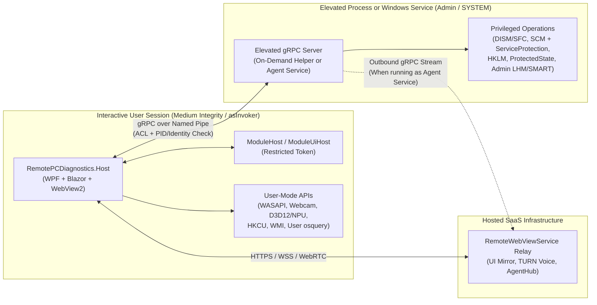
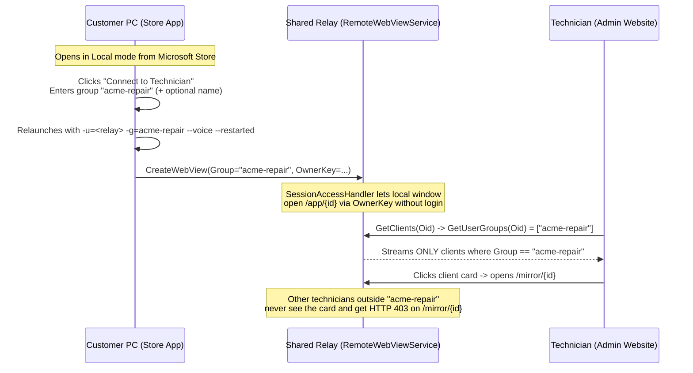

# Marketing, Monetization & Store Distribution Plan

How **Remote PC Diagnostics** makes money, reaches paying users, and ships through the Microsoft Store and direct channels without compromising security or running afoul of Windows and Store policies.

Related docs: [architecture.md](architecture.md) (as-built projects and privilege model), [module-plugins.md](module-plugins.md) (signed/unsigned plugin boundaries and host queries), and [roadmap.md](roadmap.md) (planned `RemotePCDiagnostics.Agent` service and workflow items).

---

## 1. Executive Summary & Core Thesis

Remote PC Diagnostics looks like a PC utility on the surface, but its real differentiator is a **complete remote technician and hardware QA workflow**:

- Same Blazor UI locally on the bench or shared remotely via [RemoteBlazorWebView](https://github.com/budcribar/RemoteBlazorWebView)
- Built-in WebRTC voice (`--voice`), explicit local user consent, and tamper-evident Windows Event Log session/action auditing
- Guided multi-stage service workflows (measure $\rightarrow$ remediate $\rightarrow$ reboot & resume $\rightarrow$ re-measure $\rightarrow$ before/after client report)
- Hardware verification modules rarely found in one lightweight tool (thermal-guarded stress tests, SMART drive health, battery wear, speaker-to-mic loopback, webcam frame analysis, NPU compute check)
- Planned lightweight persistent/per-session enrollment agent (`RemotePCDiagnostics.Agent`)

### Strategic Rule: Free Client Distribution, Paid Professional Workflow

Charging individual consumers \$9.99 up front for a diagnostic download puts the product into a race-to-the-bottom category against free staples (HWiNFO, OCCT, Microsoft PC Manager) and sleazy "PC cleaner" scareware—and conflicts with the repository's [MIT License](../LICENSE).

Instead:

1. **Distribute the desktop client for free in the Microsoft Store (and `winget`)** as a zero-SmartScreen, high-trust acquisition and customer-onboarding channel.
2. **Monetize the hosted infrastructure and commercial deliverables** (the hosted `RemoteWebViewService` relay, TURN voice servers, enrolled `AgentHub` computer fleet, white-labeled client service reports, and serial-numbered hardware QA certificates).
3. **Turn MIT open source into a sales asset:** IT admins, repair shops, and security-conscious users can inspect every privileged command that runs on an endpoint, while recurring revenue lives in the hosted multi-tenant SaaS layer that costs far more time to self-host than a monthly subscription.

---

## 2. Target Customer Segments

### Segment A — Independent PC Repair Shops, Solo IT Consultants & Small MSPs *(Primary Recurring Revenue)*

- **Pain today:** Paying \$60–\$150/month per technician for generic remote-desktop tools, talking anxious clients past Windows Defender SmartScreen warnings on `.exe` downloads, manually running `dism`, `sfc`, SMART checks, and HWiNFO, then typing up an invoice summary by hand to justify a \$99–\$149 tune-up fee.
- **Why they buy:**
  - **Zero-SmartScreen, no-URL client onboarding:** *"Open the Microsoft Store, install Remote PC Diagnostics, click **Connect to Technician**, and enter **`acme-repair`**"*—the customer's PC immediately appears on the technician's Admin website without reading long session URLs over the phone, while one shared relay isolates multiple shops by group.
  - **Tangible proof of work:** Automated **white-labeled Before/After Client Service Reports** (with the shop's logo, RAM/storage freed, integrity repairs, and benchmark deltas) justify the shop's service charge to the end customer.
  - **Enrolled fleet (`Computers` dashboard):** Persistent `RemotePCDiagnostics.Agent` installs keep retainer clients one click away in the same technician group without heavyweight RMM bloat.

### Segment B — Laptop Refurbishers & Used-PC Resellers *(High-Margin Vertical Wedge)*

- **Pain today:** Enterprise refurbishment suites (Blancco, PC-Doctor Service Center, Eurosoft) cost thousands of dollars annually and require sales calls, so smaller eBay, BackMarket, and local refurbishers test audio, webcams, batteries, drives, and thermals manually without buyer-verifiable proof.
- **Why they buy:**
  - Remote PC Diagnostics already covers the full bench QA checklist in one UI: model/serial inventory, battery health, SSD SMART & retrim status, CPU/GPU/RAM/Disk stress tests with thermal cutoffs, WASAPI speaker-to-microphone loopback, WinRT webcam frame/brightness checks, and NPU checks.
  - Adding a **Hosted Hardware Health Certificate** (tamper-evident PDF + hosted verification URL/QR code keyed to machine serial + timestamp) gives resellers something they can embed directly in eBay/storefront listings to command higher resale prices and fewer returns.

### Segment C — DIY Enthusiasts & "Family IT Support" Prosumers *(Organic Funnel & Impulse Tier)*

- **Pain today:** Consumer tune-up tools rely on dark patterns and fake "critical error" counts; helping a parent or friend troubleshoot a slow PC over the phone is frustrating.
- **Why they use & share it:**
  - 100% honest, ad-free local checks and stress tests build 5-star Microsoft Store ratings and organic search ranking.
  - A low-cost annual or one-time personal pass unlocks a personal group code, unlimited voice-enabled remote sessions, and reboot-and-resume workflows for helping family computers.

---

## 3. Pricing, Packaging & Store Commerce

### Tier Structure

| Tier | Price | Target User | Included |
| :--- | :--- | :--- | :--- |
| **Community (Free)** | **\$0** | Consumers, DIY bench users, evaluation | All local checks, sensors, stress/audio/webcam/NPU tests, and local fixes. Ad-hoc supervised remote sessions via direct link capped at 15 minutes (no TURN voice, standard report footer). |
| **Personal / Family Tech** | **\$19 / year** *(or \$15 30-day pass)* | Prosumers helping family & friends | Personal support group code on the Admin portal, unlimited supervised remote sessions with WebRTC voice (`--voice`), remote reboot-and-resume workflow, up to 5 enrolled family PCs. |
| **Solo Tech & Refurbisher** | **\$39 / month** *(or \$390 / year)* | Solo repair techs, mobile IT, laptop refurbishers | Dedicated shop group code (`acme-repair`), unlimited remote sessions + voice, **white-labeled Before/After Service Reports**, **Hosted Hardware QA Certificates** (QR/URL per serial), up to 50 enrolled `Agent` endpoints. |
| **Shop / Small MSP** | **\$99–\$199 / month** | Multi-tech repair shops, internal IT desks, MSPs | 3–10 technician seats in one or more groups, relay SSO/group authentication, 250–1,000 enrolled `Agent` endpoints, centralized session/remediation audit log retention, custom shop JSON checks & signed plugin deployment, unbranded reports. |

### Keeping ~97% of Revenue on PC (Store Policies `10.8.1` & `10.8.6`)

Under **Microsoft Store Policies `10.8.1` and `10.8.6`**, non-game PC applications distributed through the Microsoft Store are **explicitly permitted to use a secure third-party purchase API** (Stripe, Paddle, or Lemon Squeezy) for subscriptions and digital services rather than Microsoft's in-app billing:

- **0% Microsoft Store commission** (only standard ~2.9% + \$0.30 payment processor fees).
- **Single unified entitlement system** across Microsoft Store installs, `winget`, and direct Inno Setup / Agent deployments.
- **Compliance checklist for `10.8.2` / `10.8.6`:** Identify the payment provider at checkout, authenticate the user, allow turning off or re-authenticating purchases, allow browser handoff for account registration/checkout *after* installation completes, and declare third-party purchase API usage in Partner Center submission notes.

---

## 4. Commercial Readiness, Product Gaps & Sales Playbook

### 4.1 Realistic Odds & Unit Economics

- **Consumer B2C utility sales (<10% odds):** Consumers expect hardware diagnostics to be free (`HWiNFO`, `OCCT`, `CrystalDiskInfo`, `Microsoft PC Manager`), while paid consumer tune-up utilities are crowded out by high-ad-spend scareware.
- **Vertical B2B Micro-SaaS for Repair Shops, Solo Techs & Laptop Refurbishers (~50–65% odds of \$2k–\$10k/mo MRR in 6–12 months):**
  - **1-Job ROI:** A solo technician charging \$129 for a remote tune-up—or an eBay/BackMarket refurbisher earning +\$35 per laptop from a verified Hardware QA QR certificate—recovers a **\$39–\$99/month** subscription on a single job.
  - **90%+ Gross Margin:** Unlike full-desktop 60 fps video streaming tools, `RemoteBlazorWebView` relays lightweight UI diffs while heavy CPU/GPU/NPU benchmarks run on the endpoint. Fifty to a hundred small shops (\$3k–\$7k/mo MRR) run comfortably on modest cloud infrastructure.
  - **Positioning Discipline:** Do **not** pitch this as *"a cheaper TeamViewer"* (`RemoteBlazorWebView` mirrors the diagnostic app's UI, not the whole Windows desktop). Pitch it as **"Zero-SmartScreen Store Onboarding + Automated Bench/Remote Diagnostics + Client Proof-of-Work Reports."**

---

### 4.2 Six Must-Have Additions to Close Paying Customers

Roughly 85% of the core diagnostic engine is already built; closing B2B subscriptions requires adding the **commercial wrapper**:

1. **Self-Serve Tenant Signup, Billing & Group Claiming *(The Cash Register)*:**
   - Add self-serve shop registration + **Stripe Billing** to `RemoteWebViewAdmin` / `RemoteWebViewService` so a technician can pay \$39–\$199/mo, claim a unique `Group` code (e.g., `acme-repair`), upload shop branding (logo, phone, website), manage `enrollment_key`s, and have relay sessions automatically gated if billing lapses.
2. **Upgrade `ClientReport.cs` into White-Labeled Hosted Reports & Hardware QA Certificates *(The #1 Sales Hook)*:**
   - **White-Labeled Service Report + Share Link:** Extend `src/RemotePCDiagnostics.Core/Workflow/ClientReport.cs` with shop logo/contact headers, custom technician notes, and a 1-click **"Publish Report Link"** (`reports.<domain>/r/<short-id>`) ready to paste into repair invoices.
   - **Hardware QA Certificate Mode (for Refurbishers):** A 1-page pass/fail sheet combining **Model/Serial (`osquery`) + Battery Wear % + SMART SSD Health/Power-On Hours + Thermal Stress Pass + Speaker/Mic Loopback Pass + Webcam Pass + GPU/NPU Pass**, with a printable QR sticker/link. Enterprise refurbishment suites (Blancco, PC-Doctor) charge thousands per year for this exact deliverable.
3. **Store `Group` Onboarding & User/Admin Privilege Split:**
   - Add `-g=<group>` to `SessionLaunchOptions` + the **"Connect to Technician"** top-bar dialog in `MainLayout.razor`, switch `src/RemotePCDiagnostics.Host/app.manifest` to `asInvoker`, and ship `RemotePCDiagnostics.Admin` (`--mode=helper`) in the `Policy 10.2.9` Win32 Store installer.
4. **Finish the `RemotePCDiagnostics.Agent.exe` Service Binary *(Unlocks the \$99–\$199/mo MSP Tier)*:**
   - Build the Windows Service executable (`docs/roadmap.md#1-agent-program`) hosting both `AgentHub.Connect` and `--mode=service` Named-Pipe admin gRPC, and publish it to `winget` (`BudCribar.RemotePCDiagnostics.Agent`).
5. **Two High-Demand Bench Modules Used Daily by Techs & Refurbishers:**
   - **BSOD / Crash & WHEA Analyzer:** Parse `%SystemRoot%\Minidump` headers + `Kernel-Power` (Event 41) + `WHEA-Logger` hardware error logs into plain English (e.g., *"3 blue screens in 14 days caused by `nvlddmkm.sys`"*).
   - **Keyboard Rollover + Display Dead-Pixel / Touch Test:** A 60-second interactive key-matrix check and full-screen solid-color cycle in `RemotePCDiagnostics.UI` to complete 100% of a laptop refurbisher's physical checklist.
6. **One-Click "10-Minute Hardware Intake / QA Check" Preset:**
   - Alongside `WorkflowService`'s existing measure $\rightarrow$ fix $\rightarrow$ reboot $\rightarrow$ re-measure tune-up flow, add a hands-free bench preset (Inventory $\rightarrow$ SMART $\rightarrow$ Battery $\rightarrow$ 3-min Thermal Stress $\rightarrow$ Audio Loopback $\rightarrow$ Webcam $\rightarrow$ BSOD check $\rightarrow$ QA Certificate) so refurbishers can test 10 laptops on a bench simultaneously with minimal clicks.

---

### 4.3 Phased Go-To-Market (GTM) Rollout

#### Phase 1: Foundation, Signing & Zero-Friction Distribution (Weeks 1–4)

1. **Trusted Code Signing & Store Win32 Packaging (`Policy 10.2.9`):** Set up Azure Trusted Signing (~\$9.99/month) or SignPath Foundation (available for MIT open-source projects) to Authenticode-sign every `.exe` and `.dll` (`Host.exe`, `Admin.exe`, built-in module DLLs, `osqueryi.exe`, and the Inno Setup installer) so the unpacked Win32 installer passes both SmartScreen and Microsoft Store `Policy 10.2.9` certification without needing MSIX `rescap:allowElevation` review.
2. **Microsoft Store Listing (ASO):**
   - Target high-intent, non-spammy search terms (up to 7 search phrases per Policy `10.1.3`): *PC diagnostics*, *hardware stress test*, *SSD drive health*, *webcam microphone test*, *remote PC support*, *laptop battery check*, *system repair*.
   - Keep screenshots and copy strictly factual (Policy `10.1.1`): highlight transparent Windows native tools (`osquery`, `DISM`, `SFC`), thermal-safe stress testing, and explicit local-owner session controls.
3. **`winget` Packages for Technicians & MSP RMMs:** Publish `BudCribar.RemotePCDiagnostics` and `BudCribar.RemotePCDiagnostics.Agent` (declaring `namazso.PawnIO` under `PackageDependencies`) to `microsoft/winget-pkgs` so MSPs can deploy unattended fleet access, zero-UAC admin repairs, and full `PawnIO` hardware sensors silently with a single RMM command.

#### Phase 2: Repair Shop & Refurbisher Wedge (Weeks 5–10)

1. **Ship the Two "Money Deliverables":** White-Label Client Service Reports and Serial-Number Hardware QA Certificates with hosted verification links.
2. **Direct Outbound + Community Seeding:** Execute the segment-by-segment sales playbook in [Section 4.4](#44-tactical-b2b-sales-playbook-how-to-get-your-first-50-paying-shops) to sign the first 25 "Founding Shop" subscribers (\$25/mo locked for life in exchange for feedback and testimonials).

#### Phase 3: Product-Led Viral Loop & Fleet Retention (Months 3–6)

1. **Report Footer Attribution:** Every free and lower-tier exported Service Report / QA Certificate includes a clean *"Diagnosed & Verified with Remote PC Diagnostics"* badge linking to the product page. Every customer invoice or refurbished laptop listing becomes a warm impression.
2. **One-Click Tenant Agent Builder:** On the paid Admin Portal's **Computers** page, give subscribed shops a single button (and copyable `winget` RMM snippet) pre-bound to their tenant `group` and `enrollment_key` for recurring customer care plans.

---

### 4.4 Tactical B2B Sales Playbook (How to Get Your First 50 Paying Shops)

Do **not** buy Google or Facebook ads—ad clicks for "PC repair" target broken-PC consumers, not technicians. Sell directly where technicians and refurbishers already hang out:

#### Wedge 1 — Laptop Refurbishers on eBay, BackMarket, Swappa & Whatnot *(Fastest Cold-Outreach Close)*

- **Why they convert fastest:** You can see *every* mid-sized refurbisher publicly on eBay right now (search *"ThinkPad T14 Grade A refurbished"* or *"Dell Latitude 5420 refurbished"*, filter by sellers with 200–10,000 feedback who paste plain-text battery/SSD specs in descriptions instead of Blancco certificates).
- **How to pitch them:**
  1. Run your **10-Minute Hardware QA Check** on a real laptop and generate a clean hosted **Hardware QA Certificate** (`Model/Serial + Battery 89% + NVMe 99% + Stress/Audio/Webcam Verified`).
  2. Message or email 10 refurbisher storefronts a day (their business email/phone is usually listed in eBay Business Seller Info or their matching Shopify domain) with a 4-sentence pitch linking directly to that sample certificate:
     > *"Saw your ThinkPad T14 listings—noticed you manually type battery and SSD specs in each description. I built an MIT-open-source Windows tool that tests Battery, SMART, Stress/Thermals, Webcam, Mic/Speakers, and Keyboard in 10 minutes off a USB stick and prints a QR-verified Hardware QA Certificate buyers can click right in your eBay photos (like Carfax for refurbs, without Blancco's \$3k contract). Free locally forever, \$39/mo for hosted QR certificates with your store logo—want a 30-day free login?"*

#### Wedge 2 — Independent PC Repair Shops & Solo Mobile Techs *(Recurring Core)*

- **Where to find them:**
  1. **Google Maps ("computer repair" in mid-sized cities):** Skip Geek Squad/uBreakiFix franchises; target 1–5 person independent shops with 50+ Google reviews.
  2. **Peer communities:** **Technibble** forums, `r/computertechs`, `r/msp` (vendor promo threads / open-source tool showcases), **The Tech Tribe**, and PC repair Discord servers.
- **Lead with the "No-SmartScreen + Invoice Proof" 60-second GIF/video demo:**
  - Show two things side by side in a 60-second Loom/YouTube clip:
    1. Customer installs from the Microsoft Store (zero SmartScreen warning), types `acme-repair`, and pops onto the shop's dashboard with live voice in 15 seconds.
    2. At the end of the tune-up, 1 click produces a **branded Before/After PDF/link** with the shop's logo showing boot/memory/disk improvements and exact changes made.
  - **Pitch angle:** *"Customers don't understand what `DISM` and `SFC` did, so they question a \$129 tune-up bill. Hand them an objective Before/After report with your shop logo on every job."*

#### Wedge 3 — PC Repair & Refurbishment YouTubers *(Scalable Inbound)*

- Small-to-mid repair channels (*Salem Techsperts*, *Parts-People*, *Electronics Repair School*, ThinkPad refurbishment & homelab channels) constantly test customer laptops on camera using 5 separate tools (`CrystalDiskInfo`, `FurMark`, `HWiNFO`, camera app, browser mic test).
- **Offer free lifetime Pro accounts** with their channel logo preloaded on the QA Certificate. One organic video showing all bench tests + thermal stress + audio loopback in a single clean open-source app drives hundreds of shop trials.

#### Pricing Wedge for First 25 Customers

- Offer a **"Founding Shop Tier" (\$25/month locked for life, normally \$39/month)** for the first 25 shops who join, upload their logo, and run at least 5 real client sessions. Early shop owners will tell you every rough edge in a week and give you real quotes for your landing page.

---

## 5. Technical Architecture: User/Admin Split, gRPC & Microsoft Store Strategy

### 5.1 Why Split User Mode and Admin Mode

Currently `RemotePCDiagnostics.Host` sets `<requestedExecutionLevel level="requireAdministrator" />` in `src/RemotePCDiagnostics.Host/app.manifest`, running the WPF shell, Chromium WebView2, Blazor UI, and `RemoteBlazorWebView` inside an elevated process.

Splitting into a **User-Mode UI Client (`asInvoker`)** and an **Elevated gRPC Backend** solves major technical and Store problems at once:

1. **Gets WebView2 & Remote UI out of Administrator mode:** Running WebView2 elevated is discouraged by Microsoft—it breaks Explorer drag-and-drop via UIPI, expands attack surface, and points `%LOCALAPPDATA%` / `HKCU` at the *admin* account rather than the signed-in standard user whenever UAC prompts for separate admin credentials.
2. **Matches natural Windows session boundaries:**
   - **Belongs in the User-Mode UI Process (`Medium` integrity, interactive user session):** WebView2 & `RemoteBlazorWebView`, WebRTC `--voice`, `HKCU` startup optimizations, browser `Local State` inspection, WASAPI speaker/microphone tests, WinRT `MediaCapture` webcam test, Direct3D 12 / DXCore NPU & GPU tests, battery/power reads, and unprivileged `osqueryi.exe` tables.
   - **Belongs in the Elevated gRPC Backend (`High` / `LocalSystem` integrity):** `DISM` and `SFC` repairs, `IServiceControlBackend` (`ServiceController` start/stop/start-type with `ServiceProtection` enforced server-side), `HKLM` policy/remediation writes, `%ProgramData%\RemotePCDiagnostics\state` (`ProtectedState` change journal & workflow state), Windows Event Log source creation and privileged log queries, `HardeningKitty` baseline checks that read security policy, and admin-only SMART / `LibreHardwareMonitor` fan & MSR sensors.
3. **Reuses existing seams in `RemotePCDiagnostics`:**
   - `RemotePCDiagnostics.Core` already isolates OS mutations behind interfaces (`ISensorProvider`, `IServiceControlBackend`, `IMemorySystem`, `ISystemSettings`, `IProcessLauncher`).
   - `IHostQueries` (`src/RemotePCDiagnostics.Core/Plugins/HostQueries.cs`) already proxies `sensors.read`, `storage.drives`, `osquery.select`, and `eventlog.query` across process boundaries.
   - `RemotePCDiagnostics.Agent` (`src/RemotePCDiagnostics.Agent/Protos/agent.proto`) already establishes the gRPC service footprint.



---

### 5.2 Approaches That Do *Not* Work (OS, Driver License & Store Policy Pitfalls)

Before locking in the packaging design, avoid four dead ends:

1. **Downloading an Extension `.dll` to add Admin functionality fails on both Windows and Store rules:**
   - **OS boundary:** Windows UAC tokens exist at the **process (`.exe`)** boundary, never at the DLL boundary. If a user-mode server downloads and loads `AdminExtension.dll` into `AssemblyLoadContext`, that code **still runs as a standard user** (`Access Denied` on `sfc`, `dism`, `HKLM`, and SCM). Conversely, if the host process was *already* elevated, hiding code in a downloaded DLL didn't avoid Store elevation review—and created an elevated remote-code-loading risk.
   - **Store Policy `10.2.2`:** Explicitly prohibits changing or extending core/privileged functionality after certification via *"dynamic inclusion of code"*.
   - **Filesystem boundary:** MSIX `WindowsApps` directories are immutable, and `%ProgramFiles%\RemotePCDiagnostics\modules` requires prior elevation to write.
2. **A separate user-mode gRPC server is unnecessary for non-admin hardware access:**
   - Desktop WPF apps in the Microsoft Store run at `Medium` integrity (normal Win32 user mode, **not** inside a UWP AppContainer). `RemotePCDiagnostics.Host` already has direct access to non-admin WMI, `osqueryi.exe`, WASAPI, WinRT camera, GPU, and NPU APIs without an extra user-mode gRPC hop.
3. **An in-app Store paywall link that downloads an external NT Service or `PawnIO` gets rejected:**
   - **Store Policy `10.1.5`:** Allows post-install add-ons with user consent **"excluding non-Microsoft drivers or NT services."**
   - **Store Policy `10.3.1`:** Requires providing test credentials so Store reviewers can exercise paid/gated flows—putting a prohibited service/driver download behind a paywall still fails certification (and public `winget` URLs cannot be paywalled anyway).
4. **Bundling `PawnIO` (or extracting `PawnIO.sys`) violates Store rules and `PawnIO`'s redistribution license:**
   - **Store Policy `10.2.4`:** Prohibits dependencies on non-Microsoft drivers or NT services (exceptions are considered case-by-case *only* for WHCP-certified hardware vendor drivers; `PawnIO` is attestation-signed, not WHCP-certified).
   - **`PawnIO` license & symlink safety:** The official signed `PawnIO` binary is proprietary freeware whose redistribution permission covers *only* the unmodified `PawnIO_setup.exe` installer—extracting `PawnIO.sys` directly violates its license and causes `\\.\PawnIO` device symlink collisions across tools.
   - **Clean fallback already built:** `LibreHardwareMonitorLib` `0.9.6` in `RemotePCDiagnostics.Host.csproj` already removed legacy `WinRing0.sys` (embedding only inert user-mode PawnIO bytecode blobs used by `LenovoEcFanSource`), and `LhmSensorProvider.Read` falls back automatically to WDDM GPU temperatures (`D3dkmtGpuTemperatureSource`), APU shared-die temps, and WMI/ACPI thermal zones when `PawnIO` is absent.

---

### 5.3 Recommended Strategy: One Codebase, One Dual-Mode Binary, Two Channels

Rather than maintaining separate consumer and MSP codebases, build **one shared `RemotePCDiagnostics.Admin` / `Agent` executable** (`net10.0-windows`) that runs in two CLI modes alongside `RemotePCDiagnostics.Host` (`asInvoker`):

- **`--mode=helper --parent-pid=<pid>` (On-Demand Elevated Helper):** Spawned via `ShellExecute` (`Verb = "runas"`) only when a local user clicks **"Enable Admin Repair Mode"** (one standard Windows UAC prompt). Hosts the Named-Pipe gRPC admin server and exits automatically as soon as `Host.exe` closes.
- **`--mode=service` (Always-On MSP Windows Service):** Runs as `LocalSystem`, combining the `AgentHub.Connect` outbound relay stream (`roadmap.md#1-agent-program`) with the exact same Named-Pipe gRPC admin server—unlocking unattended access and zero-UAC admin repairs.

#### Channel 1 — Walk-In / Break-Fix Customers: Microsoft Store via Unpacked Win32 Installer (`Policy 10.2.9`)

| Store Packaging Choice | Needs `rescap:allowElevation` Approval? | Verdict |
| :--- | :--- | :--- |
| **Recommended: Unpacked Win32 Installer (`Policy 10.2.9`, `.exe` / `.msi`)** | **No** | **Highest approval odds.** Submits a versioned HTTPS URL to the Authenticode-signed Inno Setup installer (`installer/RemotePCDiagnostics.iss`). Installs outside an MSIX container into `%ProgramFiles%`, so `Host.exe` (`asInvoker`) can spawn `Admin.exe --mode=helper` via `Verb = "runas"` natively with zero MSIX restricted-capability gatekeeping while giving customers one-click Microsoft Store installation. |
| **Alternative: MSIX Package (`rescap:allowElevation`)** | **Yes** (manual Partner Center review) | **Fallback only.** Microsoft documents `allowElevation` for *"Microsoft partners or enterprise organizations to maintain existing desktop functionality."* Requires a Partner Center justification (~5+ business days, Company account) explaining why `DISM`/`SFC`/SCM have no non-admin API. Free Microsoft package signing, but higher review friction. |

- **Keep drivers and NT services 100% out of the Store package:** Exclude `PawnIO_setup.exe`, verify zero `.sys` files exist in `dotnet publish`, and do **not** register a Windows NT Service in the Store build (`Policy 10.2.4`).
- **Still unlocks ~90% of technician repair work:** Even without `PawnIO`, UAC-elevating `Admin.exe --mode=helper` unlocks `DISM`, `SFC`, Windows Service start/stop/restart, protected Event Logs, `HKLM` inspection/fixes, `HardeningKitty` security baselines, and admin NVMe/SATA SMART health, while temperatures use the built-in ACPI + WDDM fallbacks.

#### Channel 2 — Managed MSP Endpoints: Silent `winget` / RMM Fleet Deployment

Employees on MSP-managed corporate PCs (law firms, clinics, accounting offices) are typically **Standard Users without local Admin passwords**—they *cannot* click "Yes" on a UAC prompt. Meanwhile, every MSP already runs a management agent (**Microsoft Intune**, **NinjaOne**, **Datto RMM**, or **ConnectWise ScreenConnect**) as `NT AUTHORITY\SYSTEM` across every managed machine.

The MSP technician pastes **one silent background command** into Intune, NinjaOne, or ScreenConnect:

```powershell
winget install --id BudCribar.RemotePCDiagnostics.Agent --silent --accept-package-agreements --accept-source-agreements --override "install --server=https://relay.yourdomain.com --group=acme-msp --key=<enrollment-key> --consent=unattended"
```

Because the RMM runs as `SYSTEM`, **zero windows, zero installers, and zero UAC prompts appear on the employee's screen.** Within ~15 seconds, three capabilities unlock automatically:

1. **Full `PawnIO` Hardware & EC Fan Sensors:**
   - The `winget` manifest for `BudCribar.RemotePCDiagnostics.Agent` declares `namazso.PawnIO` under `Dependencies: PackageDependencies:`.
   - `winget` automatically downloads, SHA-256 verifies, and silently executes `PawnIO_setup.exe -install -silent` from the official `winget` repository before installing the agent—respecting `PawnIO`'s redistribution license and avoiding Store restrictions.
   - `PawnIoProbe.Check` detects `\\.\PawnIO`, enabling `LhmSensorProvider` and `LenovoEcFanSource` to read Intel/Ryzen CPU MSR die temperatures, voltages, motherboard SuperIO fans, and Lenovo ACPI EC fan RPMs.
2. **Unattended `AgentHub` Fleet Access:**
   - `RemotePCDiagnostics.Agent.exe install ...` writes `%ProgramData%\RemotePCDiagnostics\agent.json` (`group=acme-msp`, enrollment key, `consent=unattended`, writable only by `SYSTEM`/Admins) and starts the `RemotePCDiagnosticsAgent` Windows NT Service.
   - The service holds an outbound `AgentHub.Connect` gRPC stream (`src/RemotePCDiagnostics.Agent/Protos/agent.proto`) to the relay, so every office PC appears **Online** under `acme-msp`'s **Computers** tab on `RemoteWebViewAdmin`. Clicking **Start diagnostics** verifies `manifest.json` + `manifest.sig`, launches the cached app, and opens `/mirror/<session_id>` in the technician's browser.
3. **Zero-UAC Admin Repairs on Locked-Down Employee PCs:**
   - Because `RemotePCDiagnosticsAgent` is already running as `LocalSystem`, it hosts the Named-Pipe gRPC admin server (`--mode=service`) continuously.
   - When `Host.exe` (`asInvoker`) launches on the employee's desktop, it connects directly to that Named Pipe instead of calling `ShellExecute("runas")`—giving the technician full `DISM`, `SFC`, Service, Registry, `HardeningKitty`, and `PawnIO` capabilities even when a restricted Standard User is signed in.

#### Side-by-Side Channel Summary

| Feature | Channel 1: Microsoft Store (Walk-In / Break-Fix) | Channel 2: `winget` / RMM Agent (MSP Fleet) |
| :--- | :--- | :--- |
| **How it's installed** | Customer clicks **Install** in Microsoft Store (`Policy 10.2.9` Win32) | MSP pushes 1 silent `winget` command via Intune / NinjaOne / ScreenConnect |
| **How tech finds the PC** | Customer enters tech's `Group` code in **Connect to Technician** | PC is permanently listed in tech's `Group` on **Computers** (`AgentHub`) |
| **How Admin repairs run** | On-demand `Admin.exe --mode=helper` (**1 UAC click** by local user) | Always-on `Admin.exe --mode=service` (**Zero UAC**, works on Standard-User PCs) |
| **Kernel Driver (`PawnIO`)** | Excluded (uses WDDM GPU + APU + ACPI thermal fallbacks) | Auto-installed via `winget` dependency (full CPU MSRs + SuperIO/EC fans) |
| **Monetization** | Free Store app (0% Store fee); tech pays \$39–\$49/mo SaaS seat | Tech / MSP pays \$99–\$299/mo SaaS fleet subscription |

---

### 5.4 Mandatory Microsoft Store Certification & Security Rules (`Policies 10.1–10.4`)

To pass Microsoft Store review (Policies v7.20) and prevent Local Privilege Escalation (EoP), enforce six strict rules on the Store build and elevated helper:

1. **Zero UAC at Startup & Full Standard-User Mode (`10.1.2`, `10.3`, `10.4.2`):**
   - Change `src/RemotePCDiagnostics.Host/app.manifest` from `requireAdministrator` to `asInvoker`. Store reviewers automatically reject apps that prompt for UAC on launch.
   - If the user is a Standard User—or clicks **No** on UAC—the app must keep running cleanly in read-only diagnostic mode without crashes or nag loops. Admin actions must carry a shield badge and prompt for UAC **only** when clicked.
2. **No Store NT Service & Automatic Helper Exit (`10.2.4`, `10.4.2`):**
   - Never register a persistent Windows NT Service or Scheduled Task from the Store installer.
   - Per `10.4.2`, all app-started processes must exit when the UI closes. Pass `--parent-pid=<HostPid>` and bind `Admin.exe --mode=helper` to a Windows Job Object (`JOB_OBJECT_LIMIT_KILL_ON_JOB_CLOSE`) so the elevated helper terminates immediately if `Host.exe` closes or crashes.
3. **Zero Local Privilege Escalation (EoP) Surface (`10.2`):**
   - **Named Pipes only** (`ListenNamedPipe("RemotePCDiagnostics.Admin.<SessionId>")`)—never `127.0.0.1` TCP, which untrusted local processes or browser tabs could hit via SSRF/DNS rebinding.
   - Apply strict `PipeSecurity` ACLs (interactive user SID + `Administrators`/`SYSTEM`, denying `Anonymous` and `AppContainer`), and call `GetNamedPipeClientProcessId` on connect to verify the caller executable path and Authenticode signature match `Host.exe`.
   - **Fixed domain `.proto` allowlist** (`RunDismScanHealth`, `RunDismRestoreHealth`, `RunSfcScanNow`, `ControlService`, `ApplyCatalogFix`, `UndoChange`, `QueryAdminSensors`, `QueryEventLog`) with `ServiceProtection.Protected`, `HostCapabilities.AllowedSql`, and fix-catalog checks enforced server-side. **Never** expose generic `RunCommand` or `RunPowerShell` RPCs.
4. **No Downloaded or Unsigned Code in the Elevated Helper (`10.2.2`):**
   - `Admin.exe` executes only compiled-in or Authenticode-verified built-in modules. Unsigned third-party plugins remain strictly isolated inside the non-elevated `RemotePCDiagnostics.ModuleHost` process (`docs/module-plugins.md`).
5. **Explicit Local User Consent, Supported Windows APIs & Audit Trail (`10.2.8`):**
   - Require explicit local consent (e.g., clicking **"Enable Admin Repair Mode"** locally to trigger UAC, plus displaying a live local repair log) before a remote technician can mutate system settings, and write tamper-evident Windows Event Log entries (`2000–2006`, `1100`, `1400`) from the privileged backend.
   - Never write undocumented Windows user-choice protected registry keys (such as `UCPD.sys`-guarded default browser, file association, or taskbar pinning keys).
6. **Full Authenticode Signing & Offline Silent Installer (`10.2.9`):**
   - Sign every shipped `.exe` and `.dll` (`Host.exe`, `Admin.exe`, built-in module `.dll`s, bundled `osqueryi.exe`, and the Inno Setup installer) with a certificate chaining to a Microsoft Trusted Root CA.
   - Support silent install switches (`/VERYSILENT /SUPPRESSMSGBOXES`) and rely on Windows 11's inbox WebView2 (or an offline evergreen bundle) rather than downloading `MicrosoftEdgeWebview2Setup.exe` during installation (`10.2.9` forbids downloader stubs).

---

### 5.5 Multi-Tenant Group Onboarding & Single-Relay Isolation

Instead of asking a customer on the phone to read back a long `/mirror/<guid>` URL, one shared `RemoteWebViewService` relay can host many independent technicians and repair shops by routing sessions through **Group codes**:



#### What Already Exists in `RemoteBlazorWebView`

- **Admin Client List Filtering (`ClientIPCService.GetClients`):** Queries `IUserService.GetUserGroups(request.Oid)` for the signed-in technician and returns only connected sessions where `groups.Contains(x.Group)`.
- **Cross-Group URL Isolation (`SessionAccessHandler`):** Refuses (`403 Forbidden`) any signed-in user outside `state.Group` even if they obtain a `/mirror/{id}` link, while allowing the customer's local `MainWindow` to open `/app/{id}` unauthenticated via `OwnerKey`.
- **Client Property (`BlazorWebView.Group`):** Already transmitted in `CreateWebViewRequest.Group` (currently defaulting to `"test"`).

#### Required Wiring in `RemotePCDiagnostics` & the Relay

1. **In-App "Connect to Technician" Flow (Handling Store Launch + `HostPage` Ordering):**
   - Microsoft Store launches `RemotePCDiagnostics.Host.exe` with no arguments (Local mode), and `BlazorWebView.Group` must be assigned *before* `RemoteBlazorWebView.HostPage` is set.
   - Add a **"Connect to Technician"** button/dialog in the top bar accepting the technician's **Group / Shop Code** (e.g., `acme-repair`) and an optional **Customer Label** (e.g., *"Mary — Front Desk"*, rendered into `RemoteBlazorWebView.Markup` so busy shops can tell waiting PCs apart).
   - Submitting saves the group preference and uses the existing `--restarted` handoff (`SessionLaunchOptions`) to relaunch with `-u=<relay> -g=<group> --voice --restarted`, setting `RemoteBlazorWebView.Group = launch.Group` before `HostPage` in `MainWindow.xaml.cs`.
   - Persist `Group` in `SessionLaunchOptions.RestartArguments` and `PendingRebootState` so browser-triggered restarts and mid-workflow Windows reboots reconnect directly into the same technician's group.
2. **Group Validation & Anti-Spam on Connect:**
   - Entering a group name only *publishes* the customer's own session into that group (unauthenticated clients can never list a group's computers).
   - Validate `request.Group` on the relay against registered active tenant groups (or map short rotating/static 6-character support codes like `ACME42` $\rightarrow$ `acme-repair`) so customer typos fail fast with a clear *"Unknown technician code"* message rather than stranding the session in a nonexistent group.
3. **Unified Group Scoping for `RemotePCDiagnostics.Agent` (`agent.proto`):**
   - Bind each tenant `enrollment_key` on the relay to its owning `group`, filter `AgentAdmin.GetAgents` / `WatchAgents` by `IUserService.GetUserGroups(oid)`, and pass `-g=<group>` in `LaunchCommand`. Both ad-hoc Microsoft Store sessions (**Clients** page) and persistent enrolled endpoints (**Computers** page) then share one multi-tenant relay and authorization model.

---

### 5.6 Recommended 5-Phase Implementation Order

1. **Phase 1 — Multi-Tenant `Group` Onboarding:** Add `-g=<group>` to `SessionLaunchOptions` (including `RestartArguments` and `PendingRebootState`), add the **"Connect to Technician"** dialog in `Host`/`UI`, and enforce active tenant `Group` validation and `AgentAdmin` group scoping on the relay.
2. **Phase 2 — De-Elevate `Host.exe` (`asInvoker`):** Switch `src/RemotePCDiagnostics.Host/app.manifest` to `asInvoker` and update `HostServices` so admin-only modules and one-click fixes gracefully badge/disable themselves until an elevated backend connects.
3. **Phase 3 — `RemotePCDiagnostics.Admin` (`--mode=helper`):** Build the Named-Pipe gRPC elevated helper with `PipeSecurity` ACLs, `GetNamedPipeClientProcessId` Authenticode verification, Job Object / `--parent-pid` lifecycle exit, and the local **"Enable Admin Repair Mode"** UAC flow.
4. **Phase 4 — Store `Policy 10.2.9` Installer & `--mode=service` MSP Agent:** Add Authenticode signing and offline silent-install packaging to `installer/RemotePCDiagnostics.iss` for Microsoft Store submission, then wire `--mode=service` into `RemotePCDiagnostics.Agent.Core` and publish `BudCribar.RemotePCDiagnostics.Agent` (with `namazso.PawnIO` dependency) to `winget`.
5. **Phase 5 — Commercial Deliverables & Bench Completion:** Add self-serve tenant signup + Stripe Billing on `RemoteWebViewAdmin`, upgrade `ClientReport.cs` with shop white-labeling + hosted Hardware QA QR Certificates, ship the BSOD/WHEA and Keyboard/Display bench modules, and add the 1-click **"10-Minute Hardware Intake / QA Check"** preset.
