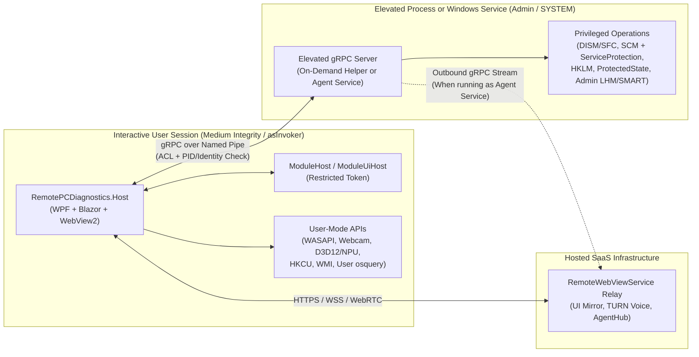

# Marketing, Monetization & Store Distribution Plan

How **Remote PC Diagnostics** makes money, reaches paying users, and ships through the Microsoft Store and direct channels without compromising security or running afoul of Windows and Store policies.

Related docs: [architecture.md](architecture.md) (as-built projects and privilege model), [module-plugins.md](module-plugins.md) (signed/unsigned plugin boundaries and host queries), and [roadmap.md](roadmap.md) (planned `RemotePCDiagnostics.Agent` service and workflow items).

---

## 1. Executive Summary & Core Thesis

Remote PC Diagnostics looks like a PC utility on the surface, but its real differentiator is a **complete remote technician and hardware QA workflow**:

- Same Blazor UI locally on the bench or shared remotely via [RemoteBlazorWebView](https://github.com/budcribar/RemoteBlazorWebView)
- Built-in WebRTC voice (`--voice`), explicit local user consent, and tamper-evident Windows Event Log session/action auditing
- Guided multi-stage service workflows (measure $\rightarrow$ remediate $\rightarrow$ reboot & resume $\rightarrow$ re-measure $\rightarrow$ before/after client report)
- Hardware verification modules rarely found in one lightweight tool (thermal-guarded stress tests, SMART drive health, battery wear, speaker-to-mic loopback, webcam frame analysis, NPU compute check)
- Planned lightweight persistent/per-session enrollment agent (`RemotePCDiagnostics.Agent`)

### Strategic Rule: Free Client Distribution, Paid Professional Workflow

Charging individual consumers \$9.99 up front for a diagnostic download puts the product into a race-to-the-bottom category against free staples (HWiNFO, OCCT, Microsoft PC Manager) and sleazy "PC cleaner" scareware—and conflicts with the repository's [MIT License](../LICENSE).

Instead:

1. **Distribute the desktop client for free in the Microsoft Store (and `winget`)** as a zero-SmartScreen, high-trust acquisition and customer-onboarding channel.
2. **Monetize the hosted infrastructure and commercial deliverables** (the hosted `RemoteWebViewService` relay, TURN voice servers, enrolled `AgentHub` computer fleet, white-labeled client service reports, and serial-numbered hardware QA certificates).
3. **Turn MIT open source into a sales asset:** IT admins, repair shops, and security-conscious users can inspect every privileged command that runs on an endpoint, while recurring revenue lives in the hosted multi-tenant SaaS layer that costs far more time to self-host than a monthly subscription.

---

## 2. Target Customer Segments

### Segment A — Independent PC Repair Shops, Solo IT Consultants & Small MSPs *(Primary Recurring Revenue)*

- **Pain today:** Paying \$60–\$150/month per technician for generic remote-desktop tools, talking anxious clients past Windows Defender SmartScreen warnings on `.exe` downloads, manually running `dism`, `sfc`, SMART checks, and HWiNFO, then typing up an invoice summary by hand to justify a \$99–\$149 tune-up fee.
- **Why they buy:**
  - **Zero-SmartScreen client onboarding:** *"Open the Microsoft Store, install Remote PC Diagnostics, and read me the session link"* works on the first try.
  - **Tangible proof of work:** Automated **white-labeled Before/After Client Service Reports** (with the shop's logo, RAM/storage freed, integrity repairs, and benchmark deltas) justify the shop's service charge to the end customer.
  - **Enrolled fleet (`Computers` dashboard):** Persistent `RemotePCDiagnostics.Agent` installs keep retainer clients one click away without heavyweight RMM bloat.

### Segment B — Laptop Refurbishers & Used-PC Resellers *(High-Margin Vertical Wedge)*

- **Pain today:** Enterprise refurbishment suites (Blancco, PC-Doctor Service Center, Eurosoft) cost thousands of dollars annually and require sales calls, so smaller eBay, BackMarket, and local refurbishers test audio, webcams, batteries, drives, and thermals manually without buyer-verifiable proof.
- **Why they buy:**
  - Remote PC Diagnostics already covers the full bench QA checklist in one UI: model/serial inventory, battery health, SSD SMART & retrim status, CPU/GPU/RAM/Disk stress tests with thermal cutoffs, WASAPI speaker-to-microphone loopback, WinRT webcam frame/brightness checks, and NPU checks.
  - Adding a **Hosted Hardware Health Certificate** (tamper-evident PDF + hosted verification URL/QR code keyed to machine serial + timestamp) gives resellers something they can embed directly in eBay/storefront listings to command higher resale prices and fewer returns.

### Segment C — DIY Enthusiasts & "Family IT Support" Prosumers *(Organic Funnel & Impulse Tier)*

- **Pain today:** Consumer tune-up tools rely on dark patterns and fake "critical error" counts; helping a parent or friend troubleshoot a slow PC over the phone is frustrating.
- **Why they use & share it:**
  - 100% honest, ad-free local checks and stress tests build 5-star Microsoft Store ratings and organic search ranking.
  - A low-cost annual or one-time personal pass unlocks unlimited voice-enabled remote sessions and reboot-and-resume workflows for helping family computers.

---

## 3. Pricing, Packaging & Store Commerce

### Tier Structure

| Tier | Price | Target User | Included |
| :--- | :--- | :--- | :--- |
| **Community (Free)** | **\$0** | Consumers, DIY bench users, evaluation | All local checks, sensors, stress/audio/webcam/NPU tests, and local fixes. Ad-hoc supervised remote sessions capped at 15 minutes (no TURN voice, standard report footer). |
| **Personal / Family Tech** | **\$19 / year** *(or \$15 30-day pass)* | Prosumers helping family & friends | Unlimited supervised remote sessions with WebRTC voice (`--voice`), remote reboot-and-resume service workflow, up to 5 enrolled family PCs. |
| **Solo Tech & Refurbisher** | **\$39 / month** *(or \$390 / year)* | Solo repair techs, mobile IT, laptop refurbishers | Unlimited remote sessions + voice, **white-labeled Before/After Service Reports** (custom logo/header), **Hosted Hardware QA Certificates** (QR/URL per serial), up to 50 enrolled `Agent` endpoints. |
| **Shop / Small MSP** | **\$99–\$199 / month** | Multi-tech repair shops, internal IT desks, MSPs | 3–10 technician seats, relay SSO/group authentication, 250–1,000 enrolled `Agent` endpoints, centralized session/remediation audit log retention, custom shop JSON checks & signed plugin deployment, unbranded reports. |

### Keeping ~97% of Revenue on PC (Store Policies `10.8.1` & `10.8.6`)

Under **Microsoft Store Policies `10.8.1` and `10.8.6`**, non-game PC applications distributed through the Microsoft Store are **explicitly permitted to use a secure third-party purchase API** (Stripe, Paddle, or Lemon Squeezy) for subscriptions and digital services rather than Microsoft's in-app billing:

- **0% Microsoft Store commission** (only standard ~2.9% + \$0.30 payment processor fees).
- **Single unified entitlement system** across Microsoft Store installs, `winget`, and direct Inno Setup / Agent deployments.
- **Compliance checklist for `10.8.2` / `10.8.6`:** Identify the payment provider at checkout, authenticate the user, allow turning off or re-authenticating purchases, allow browser handoff for account registration/checkout *after* installation completes, and declare third-party purchase API usage in Partner Center submission notes.

---

## 4. Go-To-Market (GTM) Plan

### Phase 1: Foundation, Signing & Zero-Friction Distribution (Weeks 1–4)

1. **Trusted Code Signing:** Set up Microsoft Trusted Signing (~\$10/month) or SignPath Foundation (available for MIT open-source projects) so every `.exe` and `.dll` passes SmartScreen and Store Win32 checks cleanly.
2. **Microsoft Store Listing (ASO):**
   - Target high-intent, non-spammy search terms (up to 7 search phrases per Policy `10.1.3`): *PC diagnostics*, *hardware stress test*, *SSD drive health*, *webcam microphone test*, *remote PC support*, *laptop battery check*, *system repair*.
   - Keep screenshots and copy strictly factual (Policy `10.1.1`): highlight transparent Windows native tools (`osquery`, `DISM`, `SFC`), thermal-safe stress testing, and explicit local-owner session controls.
3. **`winget` Package:** Publish `RemotePCDiagnostics` (and `RemotePCDiagnostics.Agent`) to `microsoft/winget-pkgs` so technicians can deploy from any terminal with `winget install`.

### Phase 2: Repair Shop & Refurbisher Wedge (Weeks 5–10)

1. **Ship the Two "Money Deliverables":**
   - **White-Label Client Service Report** (shop logo, technician notes, before/after RAM, disk space recovered, DISM/SFC status, drive health).
   - **Serial-Number Hardware QA Certificate** (shareable hosted card + printable sticker/PDF with QR link for refurbished laptops).
2. **Targeted Community Seeding:**
   - Share technical write-ups and free bench tools in independent repair and MSP communities (`r/computertechs`, `r/msp`, Technibble, Discord repair servers, and refurbished-hardware seller groups).
   - Pitch independent YouTube PC repair / refurbishment channels—live thermal + speaker-to-mic + webcam + before/after report workflows film well on camera.

### Phase 3: Product-Led Viral Loop & Fleet Retention (Months 3–6)

1. **Report Footer Attribution:** Every free and lower-tier exported Service Report / QA Certificate includes a clean *"Diagnosed & Verified with Remote PC Diagnostics"* badge linking to the product page. Every customer or laptop buyer becomes a warm impression.
2. **One-Click Tenant Agent Builder:** On the paid Admin Portal's **Computers** page, give subscribed shops a single button to download an installer pre-bound to their tenant enrollment key (`--key=<tenant_key>`) for persistent customer care plans.

---

## 5. Technical Architecture: User/Admin Split, gRPC & Microsoft Store Strategy

### 5.1 Why Split User Mode and Admin Mode

Currently `RemotePCDiagnostics.Host` sets `<requestedExecutionLevel level="requireAdministrator" />` in `src/RemotePCDiagnostics.Host/app.manifest`, running the WPF shell, Chromium WebView2, Blazor UI, and `RemoteBlazorWebView` inside an elevated process.

Splitting into a **User-Mode UI Client (`asInvoker`)** and an **Elevated gRPC Backend** solves major technical and Store problems at once:

1. **Gets WebView2 & Remote UI out of Administrator mode:** Running WebView2 elevated is discouraged by Microsoft—it breaks Explorer drag-and-drop via UIPI, expands attack surface, and points `%LOCALAPPDATA%` / `HKCU` at the *admin* account rather than the signed-in standard user whenever UAC prompts for separate admin credentials.
2. **Matches natural Windows session boundaries:**
   - **Belongs in the User-Mode UI Process (`Medium` integrity, interactive user session):** WebView2 & `RemoteBlazorWebView`, WebRTC `--voice`, `HKCU` startup optimizations, browser `Local State` inspection, WASAPI speaker/microphone tests, WinRT `MediaCapture` webcam test, Direct3D 12 / DXCore NPU & GPU tests, battery/power reads, and unprivileged `osqueryi.exe` tables.
   - **Belongs in the Elevated gRPC Backend (`High` / `LocalSystem` integrity):** `DISM` and `SFC` repairs, `IServiceControlBackend` (`ServiceController` start/stop/start-type with `ServiceProtection` enforced server-side), `HKLM` policy/remediation writes, `%ProgramData%\RemotePCDiagnostics\state` (`ProtectedState` change journal & workflow state), Windows Event Log source creation and privileged log queries, `HardeningKitty` baseline checks that read security policy, and admin-only SMART / `LibreHardwareMonitor` fan & MSR sensors.
3. **Reuses existing seams in `RemotePCDiagnostics`:**
   - `RemotePCDiagnostics.Core` already isolates OS mutations behind interfaces (`ISensorProvider`, `IServiceControlBackend`, `IMemorySystem`, `ISystemSettings`, `IProcessLauncher`).
   - `IHostQueries` (`src/RemotePCDiagnostics.Core/Plugins/HostQueries.cs`) already proxies `sensors.read`, `storage.drives`, `osquery.select`, and `eventlog.query` across process boundaries.
   - `RemotePCDiagnostics.Agent` (`src/RemotePCDiagnostics.Agent/Protos/agent.proto`) already establishes the gRPC service footprint.

---

### 5.2 Approaches That Do *Not* Work (OS & Store Policy Pitfalls)

Before choosing a packaging path, avoid three dead ends:

1. **Downloading an Extension `.dll` to add Admin functionality fails on both Windows and Store rules:**
   - **OS boundary:** Windows UAC tokens exist at the **process (`.exe`)** boundary, never at the DLL boundary. If a Store-approved user-mode server downloads and loads `AdminExtension.dll` into `AssemblyLoadContext`, that code **still runs as a standard user** (`Access Denied` on `sfc`, `dism`, `HKLM`, and SCM). Conversely, if the host process was *already* elevated, hiding the code in a downloaded DLL didn't avoid Store elevation review—and created an elevated remote-code-loading risk.
   - **Store Policy `10.2.2`:** Explicitly prohibits changing or extending core/privileged functionality after certification via *"dynamic inclusion of code"*.
   - **Filesystem boundary:** MSIX `WindowsApps` directories are immutable, and `%ProgramFiles%\RemotePCDiagnostics\modules` requires prior elevation to write.
2. **A separate user-mode gRPC server is unnecessary for non-admin hardware access:**
   - Packaged WPF apps in the Microsoft Store declare `runFullTrust` and run at `Medium` integrity (normal Win32 user mode, **not** inside a UWP AppContainer). `RemotePCDiagnostics.Host` already has direct access to non-admin WMI, `osqueryi.exe`, WASAPI, WinRT camera, GPU, and NPU APIs without an extra user-mode gRPC hop.
3. **Having a Store MSIX app download and install a Windows Service in-app violates Policy `10.1.5`:**
   - Store Policy `10.1.5` allows post-install add-ons *with user consent*, **"excluding non-Microsoft drivers or NT services."** Any NT service must either be installed by the Store package itself or installed independently by the user/IT admin outside the Store app (with optional external service support disclosed per Policy `10.2.4`).
4. **Never bundle or silent-install uncertified kernel drivers (`PawnIO` / `WinRing0`):**
   - Keep `LhmSensorProvider`'s existing graceful fallback to ACPI thermal zones and WDDM GPU temperature counters whenever `PawnIO` is absent. Only WHCP-certified drivers are ever considered under Store Policy `10.2.4`.

---

### 5.3 Viable Microsoft Store Delivery Paths

Build **one shared elevated gRPC server executable** (`RemotePCDiagnostics.Admin.exe` / `RemotePCDiagnostics.Agent.exe`) that can run either as an **on-demand elevated child process** (`--mode=helper`) or as a **Windows Service** (`--mode=service`). That supports all three compliant Store strategies:

| Option | Package Type | How Admin Runs | Store Review Friction | Best Fit |
| :--- | :--- | :--- | :--- | :--- |
| **Option A (Fastest Full-Feature Store Path)** | **Unpacked Win32 Installer (`Policy 10.2.9`)** | Your signed Inno Setup `.exe` (`RemotePCDiagnostics.iss`) hosted at a versioned HTTPS URL. Store runs `/VERYSILENT`; **1 UAC prompt at install is allowed by `10.2.9`** and registers the service + user-mode UI. | **Low–Medium** (Requires Company account + Trusted Root CA signature on *every* PE `.exe`/`.dll`, standalone offline installer—no web downloader stubs). | Single one-click Store install with 100% admin & unattended capability out of the box. |
| **Option B (Cleanest Pure MSIX)** | **Single MSIX + `rescap:allowElevation`** | `Host.exe` launches in user mode (`asInvoker`, 0 prompts). `Admin.exe --mode=helper` is bundled inside the same MSIX and spawned via `ShellExecute` (`Verb = "runas"`) only when the user starts admin scans/fixes, exiting when the UI closes. | **Medium** (Requires Partner Center capability justification for `runFullTrust` + `allowElevation`; much easier than `localSystemServices`). | Consumer-friendly MSIX with clean Store uninstall and zero background service when idle. |
| **Option C (Zero-Elevation Store Funnel + Companion Agent)** | **Pure User-Mode MSIX (`runFullTrust` only) + External `Agent` MSI/EXE** | Store MSIX never elevates; runs all ~18 user-mode checks/stress/media tests standalone (`Policy 10.1.2`). If a technician/admin installs `RemotePCDiagnostics.Agent` via `winget`/website, the Store app detects the Named Pipe and unlocks admin features (`Policy 10.2.4` disclosure). | **Lowest** (Standard `runFullTrust` desktop submission; fastest Store certification). | Freemium consumer Store app + MSP/Repair Shop `winget`/MSI agent deployment. |
| **Option D (Packaged MSIX Service)** | **Single MSIX + `<desktop6:Service>`** | Service declared in `Package.appxmanifest` with `rescap:packagedServices` + `rescap:localSystemServices`. (`LocalService` alone cannot run DISM/SFC or control SCM.) | **High** (`localSystemServices` undergoes ~5+ business day security review and requires a strong EoP whitepaper). | Only if strict single-file MSIX *with* zero runtime UAC prompts is required for enterprise Store deployment. |

### Recommended Rollout Sequence

1. **Split `RemotePCDiagnostics.Host` (`asInvoker`) from the Named-Pipe gRPC Admin Backend** so the app launches cleanly as a Standard User, runs every non-admin check/stress test, and badges admin-only repairs ("Requires Administrator").
2. **Ship to the Microsoft Store via Option A (Win32 Installer under `10.2.9`) or Option B (MSIX + `allowElevation`)**—note that for Option A, `RemotePCDiagnostics.iss` must bundle or rely on Windows 11's inbox WebView2 rather than downloading `MicrosoftEdgeWebview2Setup.exe` at install time (`10.2.9` forbids downloader stubs).
3. **Ship `RemotePCDiagnostics.Agent` via `winget` and the Admin Portal** using the exact same gRPC admin implementation in `--mode=service` for paid repair-shop/MSP fleets.

---

### 5.4 Mandatory Security Controls for Microsoft Approval (`Policy 10.2`)

Any elevated helper or `LocalSystem` service that listens for IPC calls is scrutinized for **Local Privilege Escalation (EoP)**. Implement these five controls from day one:

1. **Named Pipes Only — Never Localhost TCP:**
   - Host Kestrel gRPC on a Named Pipe (`ListenNamedPipe("RemotePCDiagnostics.Admin")`), never `127.0.0.1:<port>`. Local TCP ports are reachable by untrusted processes and browser SSRF/DNS-rebinding attacks.
2. **Caller Process & Identity Verification:**
   - Apply explicit `PipeSecurity` ACLs (restricting access to interactive logged-on users and Administrators/SYSTEM, rejecting `Anonymous` and `AppContainer` SIDs unless intended).
   - On connection, call `GetNamedPipeClientProcessId` and verify that the calling process binary carries your **exact MSIX Package Identity** (for MSIX builds) or **exact Authenticode certificate chain/thumbprint** (for Win32 builds).
3. **Narrow, Strongly Typed `.proto` Surface (No Generic Command Execution):**
   - Never expose `RunCommand(string exe, string args)` or `RunPowerShell(string script)`.
   - Expose fixed domain RPCs (`RunDismScanHealth`, `RunDismRestoreHealth`, `RunSfcScanNow`, `ControlService`, `ApplyCatalogFix`, `UndoChange`, `QueryAdminSensors`, `QueryEventLog`) and enforce `ServiceProtection.Protected`, `HostCapabilities.AllowedSql`, and fix-catalog allowlists **inside the elevated server**.
4. **Helper Lifecycle Tie-In (`Policy 10.4.2`):**
   - In `--mode=helper`, pass a parent process handle or monitor the Named Pipe connection and terminate the elevated helper immediately if `RemotePCDiagnostics.Host` exits or crashes, leaving zero orphaned elevated processes.
5. **Remote Consent & Audit Enforcement in the Privileged Layer:**
   - Keep writing Event IDs `2000–2006` (session lifecycle) and `1100` / `1400` (service/remediation actions) from the privileged backend so neither a compromised UI nor a remote user can suppress the local audit trail.
